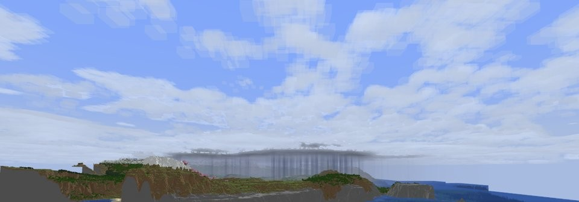
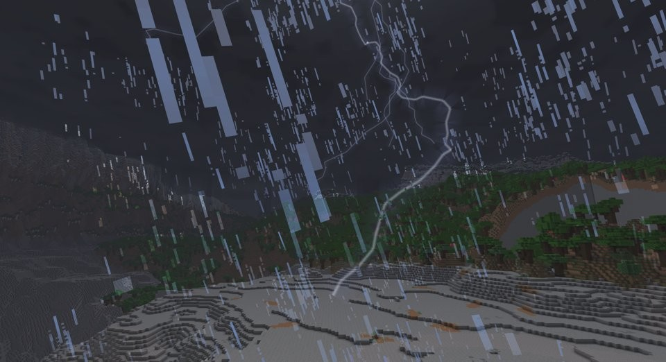
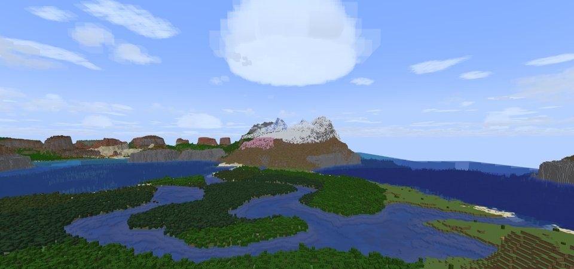
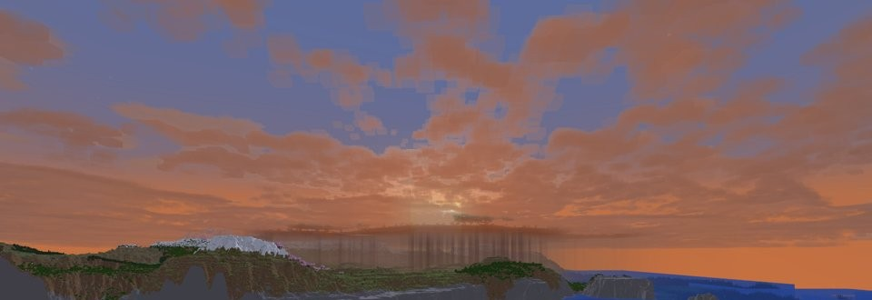

# Local Weather

Weather that happens somewhere. Instead of the whole world raining at once, Local Weather sends **storms** across it:
showers, long rain fronts and thunderstorms that form upwind, drift with the wind and die out again. It can pour in one
valley while the next one stays dry, and you can watch a storm coming from kilometres away.

For Minecraft 1.21.1, on **NeoForge** and **Fabric**. Made to go with [Better Clouds](https://modrinth.com/mod/better-clouds),
which draws the clouds the storms are made of.



## What it does

**Weather**
- Storms are real places: rain, snow, thunder and lightning only fall under them. Crops, cauldrons, snow layers and
  everything else that cares about rain follow.
- Three kinds: quick **showers**, wide **rain fronts** and **thunderstorms** with lightning in their core (warm biomes only).
- **Weather regions**: between the storms the sky changes slowly from clear to fair to overcast, in areas several km wide
  that drift with the wind. Storms gather where it is cloudy; clear spells really are clear.
- Sleeping clears only the storms over the sleeping players. `/weather` still works.

**Sky** (needs Better Clouds)
- Each storm shows as a dark cloud mass where it rains, with tall towers and a flat anvil on thunderstorms.
- Clouds are drawn much further than usual (2.5 km by default, up to 8 km), with less detail far away.
- Rain shafts hang under heavy rain in the distance, grey haze fills the air under rain clouds, and fog closes in
  while you stand in the rain.
- Lightning lights up the clouds around it; far storms flicker, and their thunder arrives later from their direction.
- Branching lightning bolts that strike exactly where the lightning lands.
- Sunsets light the clouds, storms hide the sun, overcast skies hide the stars.
- Now and then a big white cumulus heap builds up in fair weather.

| | |
|---|---|
|  |  |



## Install

- **NeoForge**: Local Weather, and [Better Clouds](https://modrinth.com/mod/better-clouds) (1.13 or newer) for the cloud
  effects.
- **Fabric**: Local Weather, [Fabric API](https://modrinth.com/mod/fabric-api) and
  [Forge Config API Port](https://modrinth.com/mod/forge-config-api-port); Better Clouds as above.
  [Mod Menu](https://modrinth.com/mod/modmenu) opens the settings.

Install it on the **server and every client**. With only one side having it, that side falls back to vanilla weather.
Better Clouds is client-only: without it the weather works, but the sky looks like vanilla's.

### Works with

- **Voxy / Roxy, Distant Horizons**: use the client preset `VOXY_TECTONIC` for clouds and weather drawn out to 6 km.
  Clouds and rain hide correctly behind far Voxy terrain.
- **Tectonic** and other tall terrain: the world setting `heightPreset = AUTO` (the default) puts the clouds above the
  real mountains.
- **Sodium, Iris, Sodium Extra, Particle Rain**: tested alongside. Shader packs are not tested yet; packs that draw
  their own sky or fog may hide some of the effects.

## Settings

Both files can be edited in the game: mod list → Local Weather → Config. Every file has a **preset**; picking one sets
everything to the preset's values, and each setting can still be changed afterwards (`CUSTOM` never changes anything).

**Client** (`config/localweather-client.toml`): how it looks. Presets `DEFAULT`, `PERFORMANCE`, `CINEMATIC`,
`VOXY_TECTONIC`.

| Section | Settings |
|---|---|
| clouds | cloud cover (without weather regions), far clouds, resolution, distance, detail distance, high layer, cumulus heaps |
| cloudHeight | follow the server's cloud height, own offset (for servers without Local Weather) |
| storms | storm towers and their height, storm darkness and its strength, thick rain clouds |
| rain | no rain above the clouds, rain shafts (strength, distance), rain haze, rain fog |
| lightning | flashes in the clouds, lightning bolts, distant thunder: heard only within your render distance (Voxy's when installed) or a fixed distance, and its volume |
| sky | sky gloom under storms, Better Clouds' rain tint, overcast sky, clouds hiding the sun and stars |

Files from before 0.1.21 are moved to the new sections automatically, keeping their values (the old file stays as
`localweather-client.toml.old`).

**World** (`config/localweather-server.toml`, or per world in `<world>/serverconfig/`):
- `heightPreset` (`AUTO`, `VANILLA`, `TECTONIC`, `TALL_TERRAIN`): where the clouds sit, and whether it stays dry above them.
  `AUTO` looks at the world's terrain around spawn and puts the clouds above most peaks.
- `weatherPreset` (`DEFAULT`, `CALM`, `STORMY`, `HUGE_STORMS`): storm size, lifetime, count, frequency and wind.
- `regions`: weather regions on or off, the sky balance (`MOSTLY_FAIR`, `BALANCED`, `MOODY`), storms following the
  regions, and (off by default) biomes making it wetter or drier.

The cloud height is the world's: players see the clouds where the server's rain starts.

## Commands

For operators (level 2):

```
/localweather list                    storms in this dimension, nearest first
/localweather here                    rain, thunder and weather region where you stand
/localweather spawn <type> [radius]   a storm (shower, rain, thunderstorm) centred on you
/localweather clear                   remove all storms
/localweather cloudheight [recompute] where the clouds sit and why
```

## Known issues

- With Voxy, far terrain shows flickering horizontal bands while walking. That is Voxy with view bobbing, not this mod:
  turn off View Bobbing.
- Only overworld-like dimensions (with sky light and no ceiling) get local weather.

## Building and contributing

See [docs/DEVELOPING.md](docs/DEVELOPING.md).
